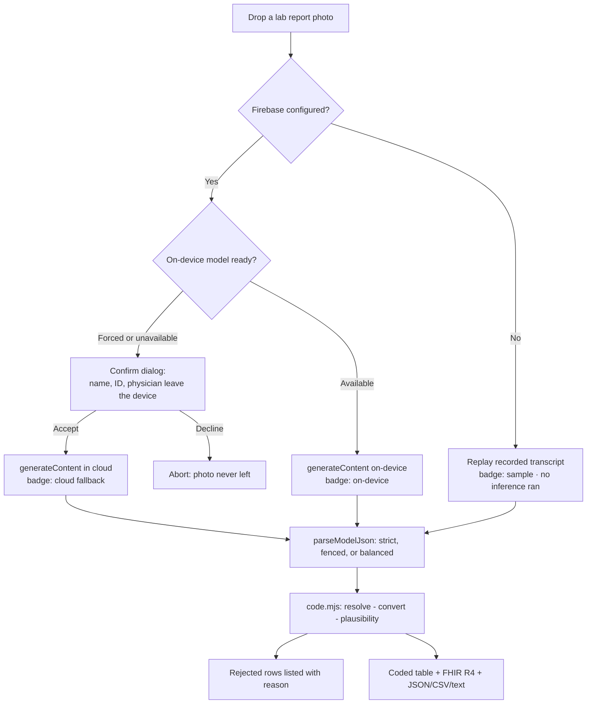
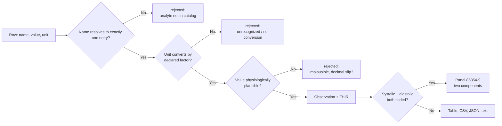

# PhotoLoinc — Diagrams

Architecture and data flow. The code is the source of truth; these diagrams
summarize `photoloinc/` for the demo and the Devpost write-up.

## Hybrid inference flow

How a photo becomes a coded report, and where the honesty badge comes from.

Key files: `app.mjs` (lifecycle, badge), `src/ai.mjs` (`PREFER_ON_DEVICE`,
`inferenceSource`), `src/prompt.mjs` (schema, tolerant parsing),
`src/code.mjs` + `src/catalog.mjs` + `src/units.mjs` (deterministic coding),
`src/pipeline.mjs` (report), `ui-*.mjs` (intake, render, exports, status).

## Deterministic coding gates (per row)

The model transcribes; it never assigns a code. Each row passes three gates;
a rejection is a first-class result that reaches the UI.

Notes:

- Urea mass (3091-6) and urea nitrogen (3094-0) are separate entries: urea
  mg/dL = BUN mg/dL x 2.14, never 1:1.
- Molar mass-to-substance conversion exists only for the six declared
  analytes; anything else is rejected, not guessed.
- Vitals carry the `vital-signs` category; chemistry keeps `laboratory`.
- No subject is passed, so the FHIR output carries no Patient reference.
